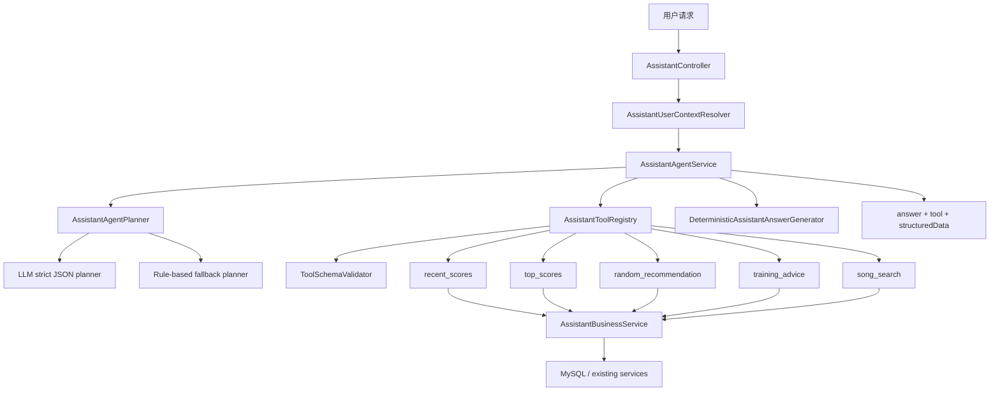
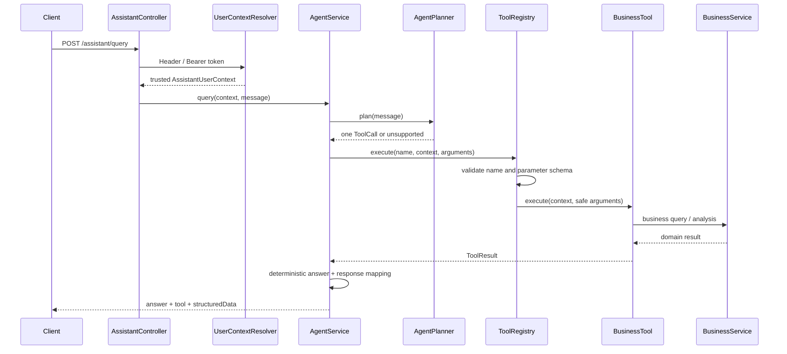

# Assistant Agent 架构说明

## 1. 当前版本边界

Assistant 当前采用轻量级单轮 Agent：

- 每次请求最多执行一个 Tool；
- LLM 只输出严格 JSON ToolCall，不使用原生 function calling；
- LLM 不接触数据库、Repository、认证信息或 Tool 执行结果；
- Tool 参数必须通过中央 Schema 校验；
- `userId` 由后端可信上下文注入，不能成为 Tool 参数；
- Tool 只处理参数读取和结果转换，查询及分析逻辑位于 Service；
- 最终 `answer` 由后端确定性生成；
- 没有多轮 Memory，也没有外部 LLM Summary 实现。

## 2. 总体结构



## 3. 请求时序



## 4. 主要组件

| 组件 | 责任 |
| --- | --- |
| `AssistantController` | 接收请求，不解析业务意图 |
| `AssistantUserContextResolver` | 开发环境解析 `X-User-Id`，生产环境解析 Bearer JWT |
| `AssistantAgentService` | 编排规划、单 Tool 限制、执行与响应组装 |
| `AssistantAgentPlanner` | 将自然语言转换成内部 `AssistantAgentPlan` |
| `LlmAssistantAgentPlanner` | 调用 OpenAI Compatible Chat Completions，并严格解析 JSON |
| `RuleBasedAssistantAgentPlanner` | LLM 关闭或异常时的确定性降级 |
| `AssistantToolRegistry` | Tool 注册、重复名称检测、查找与统一执行入口 |
| `ToolSchemaValidator` | 校验必填字段、类型、范围、长度和额外字段 |
| `AssistantBusinessService` | 成绩查询、谱面去重、推荐、训练分析和歌曲搜索 |
| `AssistantAnswerGenerator` | 最终回答扩展接口 |
| `DeterministicAssistantAnswerGenerator` | 当前唯一实现，不发生数据出站 |

## 5. ToolCall JSON 协议

LLM 只能返回一个 JSON 对象：

```json
{
  "toolName": "recent_scores",
  "arguments": {
    "limit": 5
  }
}
```

无法匹配时：

```json
{
  "toolName": "NONE",
  "arguments": {}
}
```

根节点只允许 `toolName` 和 `arguments`。不接受 Markdown、说明文字、SQL、未知 Tool 或额外字段。参数还会再次经过 Tool Registry 的 Schema 校验。

## 6. Tool 清单

| Tool | 参数 | 默认值与限制 | 业务 Service |
| --- | --- | --- | --- |
| `recent_scores` | `limit` | 默认 20，1–50 | 最近成绩查询 |
| `top_scores` | `limit` | 默认 30，1–50 | 不同谱面最高成绩查询 |
| `random_recommendation` | `count`, `minConstant`, `maxConstant` | 数量默认 5、最大 10；定数 1.0–15.9 | 定数范围随机推荐 |
| `training_advice` | `adviceCount` | 默认 3，1–5 | 确定性训练画像与建议 |
| `song_search` | `keyword`, `limit` | 关键词必填且最长 100；数量默认 10、最大 20 | 标题/曲师搜索 |

所有 Schema 均设置 `additionalProperties=false`。因此 `userId`、SQL、表名等未声明字段会被拒绝。

## 7. 用户身份信任边界

### 开发环境

优先读取 `X-User-Id`，缺失时使用 `assistant.default-user-id`。该路径只用于本地开发和演示。

### 生产环境

`prod` Profile 忽略 `X-User-Id`，必须提供：

```http
Authorization: Bearer <JWT>
```

JWT 校验成功后生成 `AssistantUserContext`。Tool 只能读取该上下文，LLM 输出中不存在合法的身份字段。

## 8. 返回协议

核心字段：

```json
{
  "answer": "已查询最近5条成绩。",
  "intent": "RECENT_SCORES",
  "parserSource": "RULE",
  "tool": {
    "name": "recent_scores",
    "plannerSource": "RULE",
    "success": true,
    "arguments": {
      "limit": 5
    }
  },
  "structuredData": {
    "scores": []
  }
}
```

为兼容旧客户端，顶层 `scores`、`recommendations`、`suggestions`、`evidence` 和 `songs` 暂时保留，并与 `structuredData` 保持一致。

## 9. 降级策略

以下情况自动从 LLM Planner 降级到 Rule Planner：

- LLM 默认关闭或配置不完整；
- 请求超时、HTTP 失败或响应为空；
- 返回非 JSON；
- JSON 根字段、Tool 名称或参数不合法；
- 参数 Schema 校验失败；
- 模型尝试添加 `userId` 等未声明字段。

Rule Planner 无法识别时返回 `UNKNOWN`，不会猜测或执行近似 Tool。

## 10. 数据出站与 Summary 策略

当前默认 `ASSISTANT_AI_ENABLED=false`，不会调用外部模型。

如果人工开启 LLM Planner，本次自然语言请求会发送到配置的规划服务，Tool 定义同时作为系统提示的一部分；Tool 结果、用户身份和业务数据不会发送。

| 数据 | 默认是否出站 | LLM Planner 开启后 |
| --- | --- | --- |
| 用户自然语言请求 | 否 | 发送给指定规划服务 |
| Tool 名称与 Schema | 否 | 发送，不包含用户数据 |
| `userId` / JWT / OpenID | 否 | 永不发送 |
| 成绩、推荐与训练 evidence | 否 | 永不发送 |
| Tool `structuredData` | 否 | 永不发送 |
| Tool 最终总结输入 | 否 | 当前没有外部 Summary 实现 |

`AssistantAnswerGenerator` 仅作为扩展点。未来若接入本地或指定测试服务，必须同时加入：

1. 默认关闭的独立 Feature Flag；
2. 明确的目标地址和数据字段白名单；
3. 敏感字段删除与输出事实校验；
4. 超时和确定性 Answer 降级；
5. 数据不出站测试。

## 11. 扩展能力

### 多 Tool

`AssistantAgentPlan` 内部已经保存 `List<AssistantAgentToolCall>`，但当前执行器硬限制最多一个 Tool。未来扩展需要同时设计多结果合并、失败语义和响应协议，不能只提高数量上限。

### 多轮 Memory

`AssistantAgentService` 已接受 `AssistantConversationContext`，Controller 当前始终传入 `empty()`。未来可在不修改 Tool 身份边界的前提下接入会话存储。

### LLM Summary

通过新增另一个 `AssistantAnswerGenerator` 实现接入。当前仓库只有确定性实现，禁止把 Tool 结果发送到外部服务。

## 12. 当前非目标

- 不实现自主循环和无限 Tool 调用；
- 不允许 LLM 生成或执行 SQL；
- 不允许 LLM 选择用户身份；
- 不实现跨请求 Memory；
- 不把 Assistant 拆成独立微服务；
- 不默认启用外部 LLM Summary。
